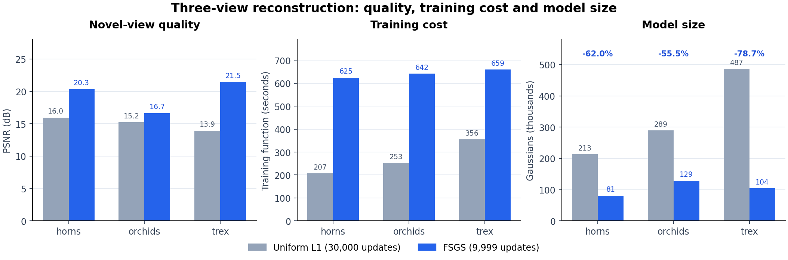
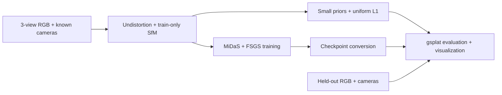

# GeoSplat-R

面向已知相机的稀疏视角 3D Gaussian Splatting 重建系统，结合训练专用 SfM 初始化、单目深度先验与 FSGS 训练，提供 **质量优先**和**快速训练**两条路径，以及统一的模型转换、独立评价和可视化输出。

[开始使用](#快速开始) · [实现说明](docs/implementation.md) · [完整结果](docs/results.md) · [环境配置](docs/environment.md)

## 核心贡献与关键收益

- **训练数据专用的重建流程：** 完成去畸变、内参同步、训练图稀疏三角化、Small 深度先验与 SfM 锚点对齐；初始化、归一化和先验均使用训练数据，测试图独立评价。
- **FSGS 与 gsplat 兼容层：** 接入固定版本 FSGS，统一真实／虚拟相机的像素采样，适配原生近裁规则，并实现高斯参数数值不变的检查点转换，使 RGB、深度及新视角视频共用一致的渲染设置。
- **更高质量与更紧凑模型：** 在 horns、orchids、trex 三个独立场景上，相对统一 L1 的场景等权 **PSNR +4.456 dB、SSIM +0.234、LPIPS −0.172**，高斯参数存储减少 **55.5%—78.7%**。
- **明确的训练成本选择：** FSGS 质量路径实测训练函数耗时约 **625—659 秒**，统一 L1 为 **207—356 秒**。两者共享运行入口和评价产物，可按质量需求与等待时间选择。

上述收益比较两套完整训练配方：FSGS 原生 10k 循环执行 9,999 次参数更新，L1 执行 30,000 次更新。测量条件和逐图变化见下表及[结果记录](results/fsgs-final-three-scenes.json)。



## 系统流程



- **L1 快训路径：** Depth Anything V2 Small 先验通过训练 SfM 锚点完成仿射逆深度对齐，在 gsplat 中进行统一 L1 深度监督。
- **FSGS 质量路径：** 使用官方优化、增密与虚拟视角深度监督配方，沿用训练稀疏初始化和本地 MiDaS DPT-Hybrid 权重。
- **统一交付：** 保存原始检查点、逐图指标、RGB／误差／深度图、有效性掩码、点云及48帧新视角视频；通过显式配置管理环境、源码、权重和输出位置。

FSGS 的 `3_views/dense/fused.ply` 是上游要求的路径名，内容仍为训练稀疏点。相机标定作为已知输入，不从三张图像重新估计全场景相机。

## 实测结果

### 独立场景图像质量

LLFF、3张训练图、504×378、seed44；horns／orchids／trex 分别包含8／4／7张测试图。主结果使用 L1 的 `standard` 与 FSGS 的 `fsgs-native` 固定渲染入口。

| 场景 | L1 PSNR ↑ | FSGS PSNR ↑ | ΔPSNR ↑ | ΔSSIM ↑ | ΔLPIPS ↓ |
|---|---:|---:|---:|---:|---:|
| horns | 15.9663 | 20.3488 | **+4.3825** | +0.2410 | -0.1352 |
| orchids | 15.2217 | 16.6572 | **+1.4355** | +0.0840 | -0.0624 |
| trex | 13.9491 | 21.4993 | **+7.5502** | +0.3757 | -0.3186 |

三个场景等权平均 PSNR 提高 **4.456 dB**；全部 **19张测试图、57项逐图指标比较**均改善。结果中同时保留 FSGS 的 standard 次要对照和原生渲染输出，逐图指标及渲染设置均可追溯。

### 训练、参数存储与渲染成本

以下各对数值按 **L1 / FSGS** 排列，测量设备为 RTX 4070 SUPER 12 GB。

| 场景 | 训练函数秒数 ↓ | 高斯数量 | 参数存储变化 ↓ | RGB+ED 渲染 ms/图 ↓ |
|---|---:|---:|---:|---:|
| horns | 206.6 / 624.6 | 213,302 / 80,966 | **−62.0%** | 1.568 / 1.237 |
| orchids | 253.3 / 641.8 | 289,212 / 128,785 | **−55.5%** | 2.172 / 1.508 |
| trex | 355.6 / 659.4 | 486,572 / 103,779 | **−78.7%** | 3.523 / 1.496 |

训练函数计时不含进程启动；存储变化按同类 float32 高斯参数张量计算，未以包含不同优化器状态的检查点文件大小替代。渲染为同一评价器预热后20次采样的均值。FSGS 在这三个场景中训练更慢，同时获得更高图像质量、更少参数和更低的实测渲染耗时。

horns 的外部显存监控仅覆盖训练前段，完整训练函数计时仍保留；完整资源记录、观测范围和失败恢复信息见[实验结果](docs/results.md)。

### 补充验证

| 验证范围 | 主要证据 | 数据 |
|---|---|---|
| fern / flower / leaves | 固定 seed44，三开发场景的质量对照 | [逐图结果](results/fsgs-development-confirmation.json) |
| room | 同阶段 L1 与 FSGS，PSNR 15.396 → 20.770 dB | [新场景结果](results/fsgs-generalization.json) |
| leaves，seeds 42/43/44 | 测试 PSNR 12.246 ± 0.045 → 17.754 ± 0.351 dB | [三种子结果](results/fsgs-generalization.json) |
| fortress | 独立场景，standard 口径 PSNR 19.978 → 24.008 dB | [独立场景结果](results/fsgs-final-fortress.json) |

补充验证表中的 FSGS 数值使用历史 standard 渲染口径，与上方原生兼容主表分别报告。leaves 使用同协议历史 L1 对照，seed44 为两次首尾重复均值；± 为三个种子的样本标准差。

## 快速开始

### 1. 环境与输入

已验证平台为 Linux / WSL，Python 3.10.22、PyTorch 2.4.1+cu124、CUDA Toolkit 12.4.1、gsplat 1.5.3；数据初始化使用独立的 Python 3.12 / pycolmap 4.2.1 环境。FSGS 使用单独环境及两个原生 CUDA 扩展。

```bash
git clone https://github.com/zchming/GeoSplat-R.git
cd GeoSplat-R
cp configs/runtime.example.json /absolute/path/to/runtime.json
```

按[环境说明](docs/environment.md)填写各 Python 环境、固定源码和本地权重位置。数据和权重需预先准备，运行入口不自动安装或下载模型。

统一入口接受以下已准备数据；原始 LLFF 子集获取、去畸变及训练初始化见[输入准备](docs/usage.md#1-准备输入)。

```text
prepared/
├── train/  images/, cameras.json, points.npz, input-manifest.json, triangulated/
└── test/   images/, cameras.json
```

### 2. 选择训练路径

设置配置、数据及输出根目录。下面两条命令是二选一示例；`SPENT=0` 适用于新的独立运行，连续运行时应从上一份 `workflow.json` 读取 `charged_seconds`，继承已用预算。

```bash
CONFIG=/absolute/path/to/runtime.json
DATA=/absolute/path/to/prepared
OUTPUT_ROOT=/absolute/path/to/outputs
SPENT=0
CAP=1200

# FSGS: quality-first training, conversion and evaluation.
python3 scripts/run_geosplat.py run --mode fsgs --config "$CONFIG"\
  --train-data "$DATA/train" --test-data "$DATA/test"\
  --output "$OUTPUT_ROOT/scene-fsgs" --seed 44\
  --inherited-seconds "$SPENT" --budget-seconds "$CAP"

# Uniform L1: faster training and evaluation.
python3 scripts/run_geosplat.py run --mode l1 --config "$CONFIG"\
  --train-data "$DATA/train" --test-data "$DATA/test"\
  --output "$OUTPUT_ROOT/scene-l1" --seed 44\
  --inherited-seconds "$SPENT" --budget-seconds "$CAP"
```

L1 已有对齐先验时可传入 `--depth-priors /absolute/path/to/priors`；否则入口先导出训练锚点并生成先验。FSGS 固定使用 MiDaS，L1 使用 Small 先验；两条路径的源码、权重与日程分别记录。

所有输出目录必须尚不存在。`CAP` 是包含历史消耗的累计秒数上限，首次编译和失败进程也计入；按实际机器与任务设置。入口记录每步退出码、时间及显存采样，超时或失败后保留现场。预算、资源和输出选项见[完整用法](docs/usage.md)。

### 3. 复用已有模型

仅生成评价与可视化时，直接使用已转换模型：

```bash
python3 scripts/run_geosplat.py evaluate --mode fsgs --config "$CONFIG"\
  --checkpoint /absolute/path/to/fsgs-run/model/model.pt\
  --train-data "$DATA/train" --test-data "$DATA/test"\
  --output "$OUTPUT_ROOT/scene-evaluation"\
  --inherited-seconds "$SPENT" --budget-seconds "$CAP"
```

L1 模型使用 `--mode l1` 和 `train/checkpoint.pt`。FSGS 的转换保留原始高斯参数；原生兼容近裁和采样规则见[实现说明](docs/implementation.md#渲染与模型转换)。

## 输出与仓库结构

一次完整运行可生成：

```text
run/
├── workflow.json                 # Configuration, commands, resources and status
├── train/                        # Training records and original checkpoint
├── model/model.pt                # Converted FSGS checkpoint
├── evaluation/
│   ├── metrics.json              # Per-view scores and renderer settings
│   ├── test-comparison.png       # GT, prediction, error and depth
│   ├── scene.ply / scene-3d.png   # Gaussian cloud and camera visualization
│   └── novel-view-path.mp4        # 48-frame novel-view trajectory
└── logs/                         # Worker logs and memory samples
```

| 路径 | 内容 |
|---|---|
| `src/geosplat_r/` | 训练、相机、深度对齐、渲染兼容与评价辅助模块 |
| `scripts/` | 数据准备、训练、模型转换和独立评价入口 |
| `configs/` | 运行环境模板、输入划分与固定实验配置 |
| `results/` | 精简指标、逐图变化、资源及代表性失败记录 |
| `tests/` | CPU 数值、数据协议、隔离与运行入口检查 |
| `patches/` | 固定上游源码的兼容补丁 |
| `docs/` | 使用、环境、实现与详细结果 |

## CPU 检查

运行入口的检查只依赖 Python 标准库，不加载模型或初始化 CUDA：

```bash
python3 -m unittest discover -s tests -p test_workflow.py
```

其他 CPU 数值、协议与几何检查由[持续集成](.github/workflows/cpu-checks.yml)运行。真实训练、模型权重和数据集使用显式外部位置。

## 适用范围与来源

当前结果对应已知相机的 LLFF 三视角、504×378 协议。深度图是模型输出的期望相机轴向 Z，图像质量改善不直接作为真实三维几何精度测量。历史统一深度、Cauchy 和 margin 对照中的局部退化及停止结论保存在[结果索引](docs/results.md#历史对照与负结果)。

本项目集成 [gsplat](https://github.com/nerfstudio-project/gsplat)、[FSGS](https://github.com/VITA-Group/FSGS)、[Depth Anything V2](https://github.com/DepthAnything/Depth-Anything-V2)、[MiDaS](https://github.com/isl-org/MiDaS) 和 [COLMAP](https://github.com/colmap/colmap) 的已有能力，数据使用 [LLFF](https://github.com/Fyusion/LLFF)。固定版本与权重身份见[环境说明](docs/environment.md)。项目侧贡献为输入与先验组织、兼容适配、统一执行和对照评价。

第三方代码、模型及数据遵循各自条款；已有 gsplat 许可文本保存在 `docs/licenses/`。本项目尚未单独选择许可证。
